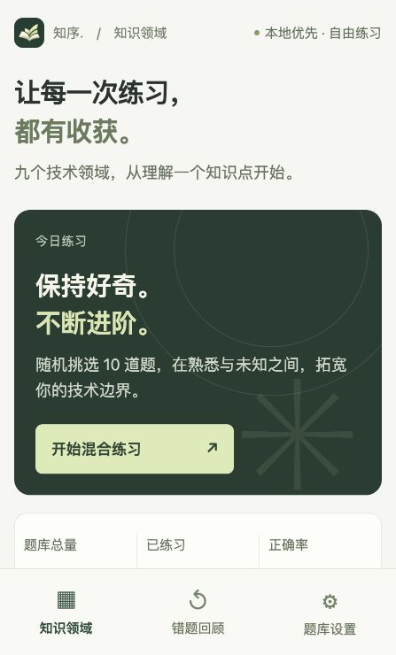
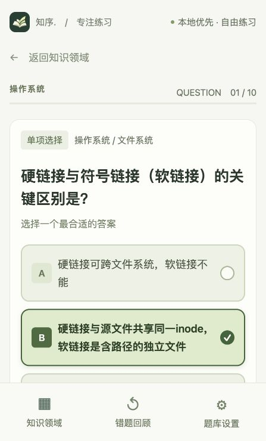

<div align="center">
  
  <h1>知序 · ZhiXu</h1>
  <p><strong>每天十题，让知识有序生长。</strong></p>
  <p>一个为手机阅读设计的技术选择题 App。离线练习，理解解析，随时追问。</p>
  <p>
    
    
    
    
  </p>
  <p><a href="https://github.com/david-dev666/zhixu/releases/latest"><strong>下载 Android 安装包</strong></a> · <a href="#开始开发">开始开发</a> · <a href="https://github.com/david-dev666/zhixu/issues">反馈问题</a></p>
</div>

<br />

<table>
  <tr>
    <td align="center"><br /><sub>按自己的节奏开始</sub></td>
    <td align="center"><br /><sub>把每一道题想明白</sub></td>
  </tr>
</table>

## 为什么是知序

技术学习很容易变成收藏资料。知序把它变成一个小动作：选一个领域，做一组题，弄懂一个知识点。

- **手机优先**：18px 正文与解析，清晰的选项卡，醒目的选中和判分状态，大按钮方便点按。
- **2700 道离线题**：九个领域各 300 道，单选与多选结合；混合练习或按领域练习，每组最多 10 道。
- **不止看答案**：每题附解析；展开「问问 DeepSeek」，可围绕题目、选项和知识点连续追问。
- **记住薄弱点**：记录探索进度和正确率，答错的题进入错题回顾，重新答对后移出。
- **题库持续生长**：选择领域后，每次调用 DeepSeek Flash 补充 10 道题，自动检查格式与重复题干。
- **本地优先**：练习无需账号，题目与记录保存在本机；安卓系统返回手势先回知识领域。

## 九个知识领域

| 领域 | 单选 | 多选 | 关注什么 |
| --- | ---: | ---: | --- |
| 操作系统 | 234 | 66 | 进程、调度、内存、文件与 I/O |
| 计算机网络 | 223 | 77 | TCP/IP、HTTP、DNS、TLS 与网络诊断 |
| C | 258 | 42 | 类型、指针、内存、编译与未定义行为 |
| Python | 244 | 56 | 对象模型、迭代、异步、并发与工程实践 |
| Agent | 219 | 81 | 工具调用、规划、上下文、恢复与评估 |
| Harness 框架 | 225 | 75 | 执行循环、沙箱、检查点、预算与回放 |
| Agent 项目调度 | 248 | 52 | DAG、并行、重试、幂等与协作验收 |
| LLM | 234 | 66 | Transformer、训练、推理、量化与部署 |
| 硬件 | 253 | 47 | CPU、GPU、内存、带宽、存储与互联 |
| **总计** | **2138** | **562** | **2700 道 · 90 个子主题** |

题库经过格式、选项约束、题干重复检查及全量 Flash 审校，尚未逐题人工审阅。发现有争议的题目，欢迎通过 issue 反馈。

## 安装到安卓手机

从 [Releases](https://github.com/david-dev666/zhixu/releases/latest) 下载 APK，传到手机后点击安装。升级时覆盖安装，可以保留本机记录；卸载应用会清除记录。

公开安装包**不包含任何 API Key**。离线练习开箱即用；需要题库更新或题目追问时，在「题库设置」中填写自己的 DeepSeek Key。模型固定为 `deepseek-flash`。

## 开始开发

Node.js 22.13+，安卓本地构建另外需要 JDK 17 和 Android SDK。

```bash
git clone https://github.com/david-dev666/zhixu.git
cd zhixu
npm ci
npm start
```

使用兼容 Expo SDK 57 的 Expo Go 扫码预览，也可以使用安卓模拟器。

浏览器开发需要两个终端：

```bash
# 终端一：配置本机服务
# 创建 .env.local，写入 DEEPSEEK_API_KEY=你的密钥
npm run api

# 终端二：网页预览
npm run web -- --host localhost --port 8081
```

访问 `http://localhost:8081`。本机服务只监听 `127.0.0.1:8082`，网页代码不包含 Key。

## 构建 APK

```bash
npm ci
npm run provision:public
npx expo prebuild --platform android --no-install
cd android
./gradlew assembleRelease
```

产物：`android/app/build/outputs/apk/release/app-release.apk`。当前本地构建使用开发签名，适合个人安装；商店分发需要自行配置签名。

个人私用包可运行 `npm run provision:key`，从本机 `.env.local` 生成 `src/embedded-key.local.ts`。该文件被 Git 忽略，仅原生端引用。不要把含私人 Key 的安装包上传到公开 Release。

## 维护与检查

```bash
npm run typecheck       # TypeScript
npm test                # 判分、追问接口、安卓返回
npm run check:bank      # 题数、选项与重复题干
npm run generate:bank   # 生成题库，可断点续跑
npm run review:bank     # 全量审校，可断点续跑
```

生成、审校和在线问答会产生 DeepSeek API 费用。本地记录和追加题目目前没有云同步。

## 技术栈

Expo SDK 57 · React Native · TypeScript · AsyncStorage · DeepSeek Flash

[MIT License](LICENSE) · david-dev666
